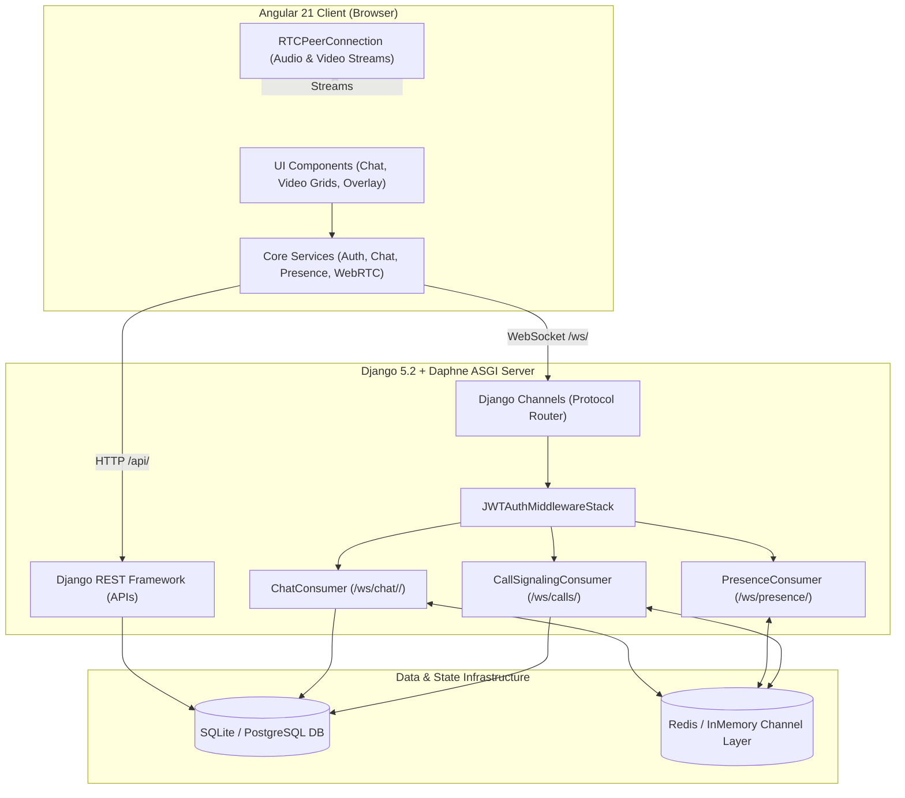
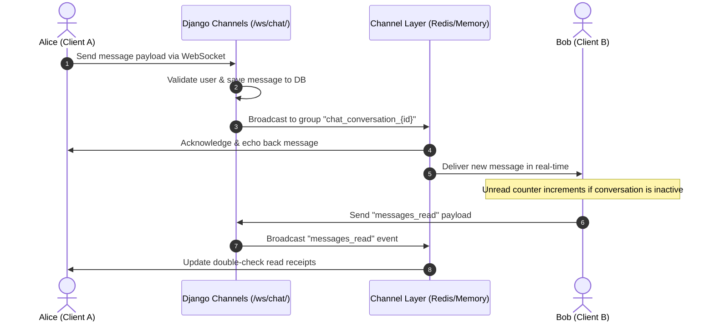

# Architecture & Codebase Walkthrough Guide
### Real-Time Communication Platform (Chat, Presence & Audio/Video WebRTC)

This document provides a comprehensive, structure-wise explanation of the entire platform. It explains the system design, file-by-file organization, data flows, real-time protocols, and engineering patterns.

---

## 1. High-Level System Architecture

The platform uses a hybrid **Client-Server + Peer-to-Peer (P2P)** architecture:

* **HTTP / REST APIs:** Used for state mutations, authentication, fetching message history, user directories, and call records.
* **WebSockets (Django Channels):** Used for low-latency bidirectional events:
  1. **Presence:** User online/offline heartbeats.
  2. **Chat:** Real-time messaging, typing indicators, and read receipts.
  3. **WebRTC Signaling:** SDP Offer/Answer exchanges and ICE candidate routing.
* **WebRTC Peer-to-Peer (P2P):** Once signaling is complete, media streams (microphone audio and camera video) travel directly between user browsers with sub-second latency.



---

## 2. Codebase Organization & File-by-File Breakdown

```text
realtime-communication-platform/
├── backend/                          # Django Backend Application
│   ├── commute/                      # Central Django Settings & ASGI Router
│   │   ├── settings.py               # Installed apps, JWT, Channel layers, CORS
│   │   ├── asgi.py                   # ProtocolTypeRouter (HTTP & WebSocket routing)
│   │   ├── urls.py                   # Top-level URL routing (/admin/, /api/)
│   │   ├── api_urls.py               # Routes /api/auth/, /api/users/, /api/calls/, chat
│   │   └── views.py                  # Health check view (/api/health/)
│   │
│   ├── users/                        # Authentication & User Management
│   │   ├── models.py                 # Custom User model (email, name, avatar, status)
│   │   ├── views.py                  # Register, Login, Refresh, Profile Me, Directory
│   │   ├── serializers.py            # User, Profile, and Token Serializers
│   │   └── urls.py / api_urls.py     # Auth and user query routes
│   │
│   ├── chat/                         # Chat, Conversations & Real-Time Presence
│   │   ├── models.py                 # Conversation, ConversationParticipant, Message
│   │   ├── consumers.py              # ChatConsumer and PresenceConsumer
│   │   ├── middleware.py             # JWT WebSocket authentication middleware
│   │   ├── views.py                  # Conversation and Message REST ViewSets
│   │   ├── serializers.py            # Message & Conversation DRF Serializers
│   │   └── routing.py                # /ws/presence/ and /ws/chat/<id>/ routes
│   │
│   └── calls/                        # Audio & Video WebRTC Calling
│       ├── models.py                 # Call model (status, duration, type: audio/video)
│       ├── consumers.py              # CallSignalingConsumer (SDP & ICE exchange)
│       ├── views.py                  # Call history & call detail REST views
│       ├── serializers.py            # Call history DRF serializers
│       └── routing.py                # /ws/calls/ route
│
├── frontend/                         # Angular 21 Single Page Application
│   ├── src/
│   │   ├── app/
│   │   │   ├── core/                 # Shared Services, Guards, Models, Interceptors
│   │   │   │   ├── guards/           # auth.guard.ts, public.guard.ts
│   │   │   │   ├── interceptors/     # jwt.interceptor.ts, error.interceptor.ts
│   │   │   │   ├── models/           # auth, user, chat, call TypeScript models
│   │   │   │   └── services/
│   │   │   │       ├── auth.service.ts       # JWT token management & session
│   │   │   │       ├── user.service.ts       # User discovery & profile updates
│   │   │   │       ├── chat.service.ts       # Conversations, messages, chat socket
│   │   │   │       ├── presence.service.ts   # Online users tracking socket
│   │   │   │       ├── webrtc.service.ts     # P2P connection, signaling, camera/mic
│   │   │   │       ├── call.service.ts       # Call history REST client
│   │   │   │       ├── alert.service.ts      # Toast notification system
│   │   │   │       └── health.service.ts     # Backend connectivity monitoring
│   │   │   │
│   │   │   └── features/             # Feature Components & Views
│   │   │       ├── auth/             # Login & Register components
│   │   │       ├── profile/          # User Profile component
│   │   │       └── chat/             # Main Chat Dashboard
│   │   │           ├── chat.component.ts               # Master layout orchestrator
│   │   │           └── components/
│   │   │               ├── conversation-list/          # Sidebar with unread badges
│   │   │               ├── message-window/             # Message stream & call actions
│   │   │               ├── message-input/              # Message composer
│   │   │               ├── incoming-call-modal/        # Incoming audio/video call modal
│   │   │               ├── active-call-overlay/        # Glassmorphic active call UI
│   │   │               └── call-history-modal/         # Chronological call history log
│   │   │
│   │   └── environments/             # environment.ts (API & WS URLs, STUN servers)
│   │
│   └── package.json                  # Dependencies (Angular 21, RxJS, Vitest)
│
├── docs/                             # Architecture & Signaling Specifications
├── specs/                            # Project requirements & Issue tracking
├── TRACKING.md                       # Milestone & GitHub issue progress tracker
└── README.md                         # Main Project Overview & Quick Start
```

---

## 3. Authentication & Security Pipeline

1. **Token Storage & Interception:**
   * Upon login or registration, the backend returns a **JWT Access Token** (short-lived) and a **Refresh Token** (long-lived).
   * The tokens are stored in `localStorage` by [`AuthService`](file:///c:/Users/jajay/realtime-communication-platform/frontend/src/app/core/services/auth.service.ts).
   * [`jwt.interceptor.ts`](file:///c:/Users/jajay/realtime-communication-platform/frontend/src/app/core/interceptors/jwt.interceptor.ts) intercepts every outgoing HTTP request to `/api/` and attaches:
     `Authorization: Bearer <access_token>`
2. **Automatic Token Rotation & Retries:**
   * [`error.interceptor.ts`](file:///c:/Users/jajay/realtime-communication-platform/frontend/src/app/core/interceptors/error.interceptor.ts) catches any HTTP 401 Unauthorized errors.
   * It pauses pending requests, calls `/api/auth/refresh/` to obtain a fresh access token, and retries the original failed requests seamlessly without logging the user out.
3. **WebSocket Authentication:**
   * [`JWTAuthMiddlewareStack`](file:///c:/Users/jajay/realtime-communication-platform/backend/chat/middleware.py) authenticates WebSocket handshakes by extracting the JWT token from the connection query parameter (`ws://...?token=<JWT>`).
   * It decodes the token, verifies the user signature, and attaches the user instance to `scope['user']`. Invalid tokens are rejected with WebSocket close code `4401`.

---

## 4. Real-Time Chat & Presence Flow



* **Typing Indicators:** When a user types in `MessageInputComponent`, a debounced `typing` signal is sent across the socket and displays animated dots in the peer's `MessageWindowComponent`.
* **Presence Tracking:** When a client mounts, [`PresenceService`](file:///c:/Users/jajay/realtime-communication-platform/frontend/src/app/core/services/presence.service.ts) connects to `/ws/presence/`. Django Channels joins the user to the `presence` broadcast group, marking them as online and notifying all contacts.

---

## 5. WebRTC Audio & Video Calling Architecture

### A. Signaling Message Protocol

All call signaling messages travel over `/ws/calls/` as JSON frames:

| Event Type | Sent By | Description |
| ---------- | ------- | ----------- |
| `call_initiate` | Caller | Requests a new call session with `callee_id` and `call_type` (`audio` or `video`). |
| `call_initiated`| Server | Confirms call creation to the caller with the allocated `call_id`. |
| `call_invite` | Server | Sends an incoming call invite notification to the callee's personal group. |
| `call_accept` | Callee | Accepts the incoming call and marks the call as `ongoing` in the DB. |
| `call_accepted`| Server | Signals the caller that the callee accepted, prompting SDP offer creation. |
| `call_reject` | Callee | Rejects call (reasons: `'declined'`, `'busy'`). |
| `sdp_offer` | Caller | Transmits caller's WebRTC Session Description Protocol offer. |
| `sdp_answer` | Callee | Transmits callee's WebRTC Session Description Protocol answer. |
| `ice_candidate`| Both | Exchanges network routing candidates (STUN/TURN IP & port pairs). |
| `call_end` | Either | Terminates active call session and triggers duration calculation in DB. |

---

### B. End-to-End Call Sequence

```mermaid
sequenceDiagram
    autonumber
    actor Caller as Caller Browser
    participant Server as Django Channels (/ws/calls/)
    actor Callee as Callee Browser

    Note over Caller: User clicks Call icon (Audio or Video)
    Caller->>Caller: Capture local media (getUserMedia)
    Caller->>Server: {"type": "call_initiate", "callee_id": 2, "call_type": "video"}
    Server->>Server: Create Call record in DB
    Server-->>Caller: {"type": "call_initiated", "call_id": 101}
    Server->>Callee: {"type": "call_invite", "call_id": 101, "call_type": "video"}

    Note over Callee: IncomingCallModal displays with pulse rings
    Callee->>Callee: Click Accept Call -> Capture local media
    Callee->>Server: {"type": "call_accept", "call_id": 101}
    Server->>Caller: {"type": "call_accepted", "call_id": 101}

    Note over Caller: Caller creates RTCPeerConnection
    Caller->>Caller: pc.createOffer() & pc.setLocalDescription()
    Caller->>Server: {"type": "sdp_offer", "call_id": 101, "payload": offer}
    Server->>Callee: {"type": "sdp_offer", "call_id": 101, "payload": offer}

    Note over Callee: Callee creates RTCPeerConnection
    Callee->>Callee: pc.setRemoteDescription(offer)
    Callee->>Callee: pc.createAnswer() & pc.setLocalDescription()
    Callee->>Server: {"type": "sdp_answer", "call_id": 101, "payload": answer}
    Server->>Caller: {"type": "sdp_answer", "payload": answer}
    Caller->>Caller: pc.setRemoteDescription(answer)

    par ICE Candidate Exchange
        Caller->>Server: {"type": "ice_candidate", "payload": candidate}
        Server->>Callee: Deliver candidate
        Callee->>Server: {"type": "ice_candidate", "payload": candidate}
        Server->>Caller: Deliver candidate
    end

    Note over Caller,Callee: WebRTC P2P Connection ESTABLISHED
    Caller<=>>Callee: Direct Audio & Video Streaming
```

---

### C. Video Call Features & Layout Engine

* **Picture-in-Picture (PiP) Grid:**
  * Remote video stream occupies the primary full-width canvas.
  * Local user stream is rendered in a mirrored, floating thumbnail in the bottom-right corner.
  * Users can click/tap the thumbnail to swap local and remote views dynamically.
* **Camera Mute & Fallbacks:**
  * When a user clicks the camera button, `toggleVideo()` disables the local video track.
  * The remote peer's UI detects `track.onmute` and reactively renders a glassmorphic avatar card with the notice: *"Camera is turned off"*.
* **Dynamic Mid-Call Renegotiation (`upgradeToVideo`):**
  * When in an audio call, users can click **Turn On Camera**.
  * The service acquires a video track via `getUserMedia()`, adds it to the active `RTCPeerConnection`, and fires `pc.onnegotiationneeded` to renegotiate the session to video without dropping the connection.
* **Camera Switching (`switchCamera`):**
  * On mobile devices with front and back cameras, `switchCamera()` cycles cameras using `RTCRtpSender.replaceTrack()` smoothly without needing full renegotiation.
* **Fullscreen Support:**
  * Uses the HTML5 Fullscreen API to expand the video session to full screen.

---

## 6. How to Run and Test the Platform

### 1. Start Backend Server
```bash
cd backend
.\.venv\Scripts\activate
python manage.py runserver 127.0.0.1:8000
```

### 2. Start Frontend Server
```bash
cd frontend
npm start
```
Open **`http://localhost:4200`** in two different browser windows (or one incognito window) to test real-time chat, presence, and audio/video calls between two users!

### 3. Run Automated Tests
* **Backend Test Suite (Django):**
  ```bash
  cd backend
  python manage.py test users chat calls commute
  ```
* **Frontend Test Suite (Vitest):**
  ```bash
  cd frontend
  npm test -- --watch=false
  ```
