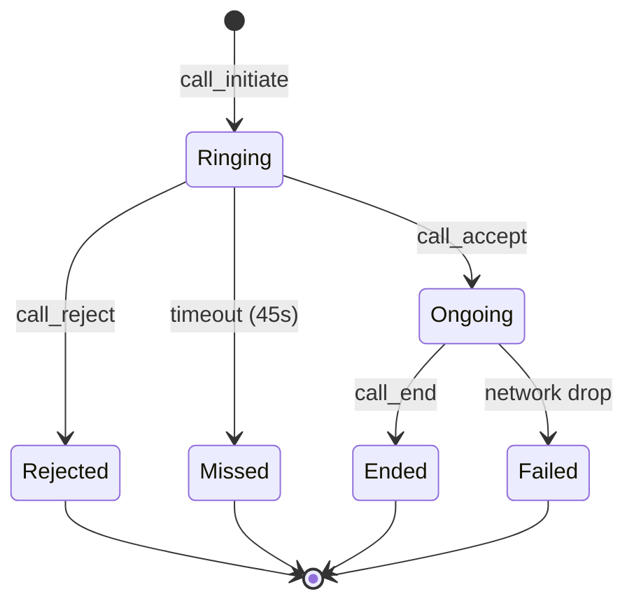

# WebRTC Signaling Protocol Specification & Message Schemas

**Issue Reference:** [#26](https://github.com/Ajay-Nayak23/real-time-communication/issues/26)  
**Milestone:** 6. WebRTC Signaling  

---

## 1. Overview

WebRTC establishes peer-to-peer audio and video media streams directly between browser clients. However, browsers cannot discover or connect to each other without an out-of-band signaling mechanism. 

The **WebRTC Signaling Architecture** in this platform uses **Django Channels WebSockets** (`/ws/calls/` and personal user channel groups `user_<user_id>`) to exchange call control sessions, Session Description Protocol (SDP) offers and answers, and Interactive Connectivity Establishment (ICE) network candidates.

```
+------------+                 +-----------------+                 +------------+
|  Caller    |                 | Django Channels |                 |  Callee    |
| (Browser)  |                 |    Signaling    |                 | (Browser)  |
+-----+------+                 +--------+--------+                 +-----+------+
      |                                 |                                |
      | 1. CALL_INITIATE                |                                |
      |-------------------------------->| 2. CALL_RINGING                |
      |                                 |------------------------------->|
      |                                 |                                |
      |                                 | 3. CALL_ACCEPT (or REJECT)     |
      | 4. CALL_ACCEPTED                |<-------------------------------|
      |<--------------------------------|                                |
      |                                 |                                |
      | 5. SDP_OFFER                    |                                |
      |-------------------------------->| 6. SDP_OFFER                   |
      |                                 |------------------------------->|
      |                                 |                                |
      |                                 | 7. SDP_ANSWER                  |
      | 8. SDP_ANSWER                   |<-------------------------------|
      |<--------------------------------|                                |
      |                                 |                                |
      | 9. ICE_CANDIDATE                | 9. ICE_CANDIDATE               |
      |<===============================>|<==============================>|
      |                                 |                                |
      |================= P2P ENCRYPTED AUDIO/VIDEO STREAM ==============>|
      |                                                                  |
      | 10. CALL_END                                                     |
      |-------------------------------->| 11. CALL_ENDED                 |
      |                                 |------------------------------->|
```

---

## 2. WebSocket Connection & Authentication

- **Endpoint:** `/ws/calls/`
- **Authentication:** JWT Bearer token passed via URL query parameter:
  ```
  ws://127.0.0.1:8000/ws/calls/?token=<JWT_ACCESS_TOKEN>
  ```
- **Connection Security:**
  - Token verified via `JWTAuthMiddleware`.
  - Non-authenticated connections rejected with close code `4401`.
  - On connection, client joins user channel group: `user_<user_id>`.

---

## 3. Standard Message Envelope

All signaling messages conform to the following unified JSON schema:

```json
{
  "type": "string",
  "call_id": 101,
  "caller_id": 1,
  "callee_id": 2,
  "call_type": "audio",
  "payload": {}
}
```

### Top-Level Fields

| Field | Type | Description |
| :--- | :--- | :--- |
| `type` | string | Signaling event identifier (e.g. `call_initiate`, `sdp_offer`, `ice_candidate`). |
| `call_id` | integer | Unique identifier of the persisted `Call` session in the database. |
| `caller_id`| integer | User ID of the call initiator. |
| `callee_id`| integer | User ID of the call recipient. |
| `call_type`| string | Media mode: `'audio'` or `'video'`. |
| `payload` | object | Event-specific data payload (SDP descriptions, ICE candidate objects, error reasons). |

---

## 4. Signaling Event Types & Payloads

### 4.1. `call_initiate`
Dispatched by Caller to invite Callee to a call. Server validates participants, persists `Call` session with status `ringing`, and forwards invite to Callee.

**Client -> Server:**
```json
{
  "type": "call_initiate",
  "callee_id": 2,
  "call_type": "audio"
}
```

**Server -> Callee (`call_invite`):**
```json
{
  "type": "call_invite",
  "call_id": 101,
  "caller_id": 1,
  "caller_name": "Alice Johnson",
  "caller_avatar": "https://example.com/avatar.jpg",
  "call_type": "audio",
  "created_at": "2026-10-25T02:50:00Z"
}
```

---

### 4.2. `call_accept`
Dispatched by Callee when accepting the incoming call invitation. Server updates `Call.status = 'ongoing'`, sets `started_at = now`, and forwards acceptance to Caller.

**Client -> Server:**
```json
{
  "type": "call_accept",
  "call_id": 101
}
```

**Server -> Caller (`call_accepted`):**
```json
{
  "type": "call_accepted",
  "call_id": 101,
  "callee_id": 2,
  "started_at": "2026-10-25T02:50:05Z"
}
```

---

### 4.3. `call_reject`
Dispatched by Callee to decline or reject the incoming call. Server updates `Call.status = 'rejected'`, sets `ended_at = now`, and notifies Caller.

**Client -> Server:**
```json
{
  "type": "call_reject",
  "call_id": 101,
  "reason": "declined"
}
```

**Server -> Caller (`call_rejected`):**
```json
{
  "type": "call_rejected",
  "call_id": 101,
  "reason": "declined"
}
```

---

### 4.4. `sdp_offer`
Dispatched by Caller after call acceptance to transmit the WebRTC Session Description Protocol (SDP) offer.

**Client -> Server -> Peer:**
```json
{
  "type": "sdp_offer",
  "call_id": 101,
  "payload": {
    "type": "offer",
    "sdp": "v=0\r\no=- 52458925 2 IN IP4 127.0.0.1\r\ns=-\r\nt=0 0\r\nm=audio 9 UDP/TLS/RTP/SAVPF 111 ...\r\n"
  }
}
```

---

### 4.5. `sdp_answer`
Dispatched by Callee in response to `sdp_offer` with their session parameters.

**Client -> Server -> Peer:**
```json
{
  "type": "sdp_answer",
  "call_id": 101,
  "payload": {
    "type": "answer",
    "sdp": "v=0\r\no=- 78451296 2 IN IP4 127.0.0.1\r\ns=-\r\nt=0 0\r\nm=audio 9 UDP/TLS/RTP/SAVPF 111 ...\r\n"
  }
}
```

---

### 4.6. `ice_candidate`
Dispatched by either peer whenever their local WebRTC engine generates a new network candidate (host, srflx from STUN, or relay from TURN).

**Client -> Server -> Peer:**
```json
{
  "type": "ice_candidate",
  "call_id": 101,
  "payload": {
    "candidate": "candidate:842163049 1 udp 1677729535 192.168.1.100 54123 typ host ...",
    "sdpMid": "0",
    "sdpMLineIndex": 0
  }
}
```

---

### 4.7. `call_end`
Dispatched by either peer to terminate the active call. Server updates `Call.status = 'ended'`, sets `ended_at = now`, calculates `duration`, and closes peer sessions.

**Client -> Server:**
```json
{
  "type": "call_end",
  "call_id": 101,
  "reason": "completed"
}
```

**Server -> Peer (`call_ended`):**
```json
{
  "type": "call_ended",
  "call_id": 101,
  "duration": 42,
  "ended_at": "2026-10-25T02:50:47Z",
  "reason": "completed"
}
```

---

## 5. Call State Transition Table


